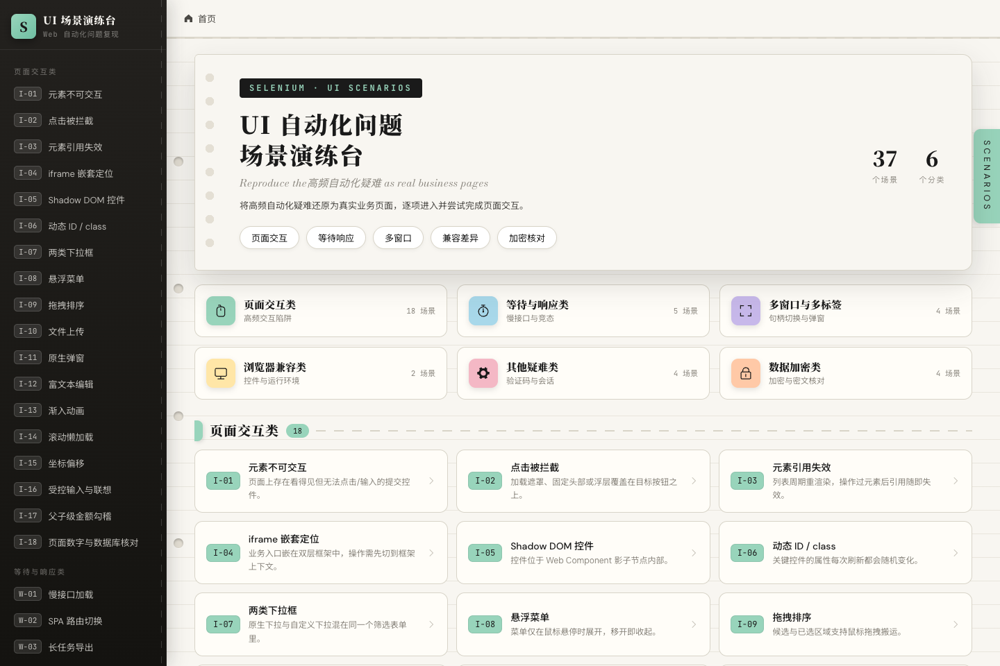
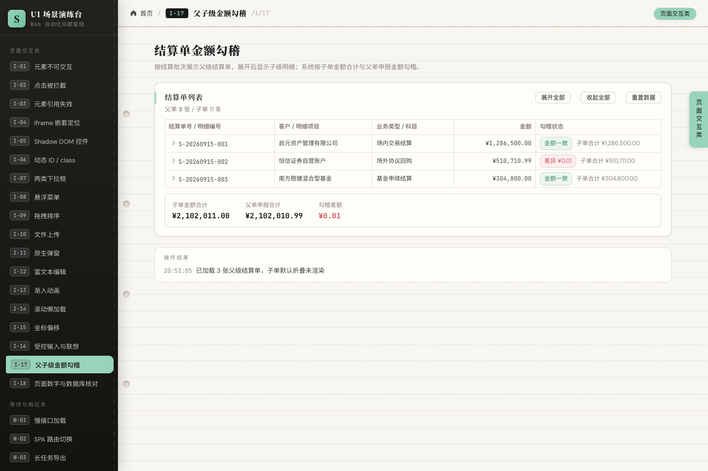
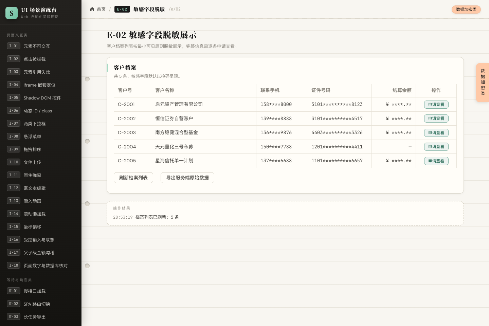

# Selenium UI Failure Playground (Vue 3 + Flask)

[](https://github.com/KaiqiZing/FirstSeleniumUIEvent/actions/workflows/ci.yml)
[](./LICENSE)
[](https://vuejs.org)
[](https://flask.palletsprojects.com)
[](https://github.com/KaiqiZing/FirstSeleniumUIEvent/releases)

[简体中文](./README.zh-CN.md) | **English**

A hands-on practice range that turns the common Selenium Web UI automation failures listed in [selenium_common_problems.md](./selenium_common_problems.md) into **real-looking business pages that behave badly on purpose**. Point a WebDriver at the matching route and you can reproduce element-not-interactable, click interception, stale references, nested iframes, Shadow DOM, fake dropdowns, native dialogs, race conditions, multi-window flows, CAPTCHAs, field-level encryption, masked display, ciphertext storage and signed payloads.

The pages contain **no hints and no answers**; every reproduction step, solution note and "cannot be reproduced in a browser" caveat lives in this document.

> **Scope and safety notice**
> This project is a **local practice range**. It intentionally ships insecure design: a hard-coded `SECRET_KEY`, a universal CAPTCHA `1234` enabled by default, a `0.0.0.0` bind, a `CRYPTO_ECHO_PLAINTEXT` plaintext-echo backdoor and unauthenticated data-seeding endpoints.
> Run it locally or on an isolated network only. **Never expose it to the public internet and never use it in production.**

---

## Screenshots

| Home (37 scenarios / 6 groups) | Scenario I-17: parent/child amounts | Scenario E-02: masked fields |
| --- | --- | --- |
|  |  |  |

---

## Table of contents

- [1. Quick start](#1-quick-start)
- [2. Scenario catalog](#2-scenario-catalog)
- [3. Per-scenario reproduction and solution notes](#3-per-scenario-reproduction-and-solution-notes)
- [4. Backend API contract](#4-backend-api-contract)
- [5. What cannot be reproduced here](#5-what-cannot-be-reproduced-here)
- [6. Practice suggestions](#6-practice-suggestions)
- [7. Contributing and license](#7-contributing-and-license)

---

## 1. Quick start

### 1.1 Requirements

| Dependency | Version | Purpose |
| --- | --- | --- |
| Node.js | ≥ 20.19 (or ≥ 22.12 — a hard requirement of Vite 8; developed on 22+) | Frontend build via Vite |
| Python | ≥ 3.9 (verified on 3.13 / 3.14) | Flask backend |
| cryptography | ≥ 42 (pinned to 50.0.1 in `requirements.txt`) | RSA-OAEP / AES-GCM / HMAC in the crypto scenarios |

### 1.2 Start the backend (port 5050)

```bash
cd backend
pip install -r requirements.txt   # first run only
python app.py
# health check: GET http://127.0.0.1:5050/api/health
```

### 1.3 Start the frontend (port 5173)

```bash
cd frontend
npm install        # first run only
npm run dev
# open http://127.0.0.1:5173
```

A Vite proxy forwards `/api/*` to `127.0.0.1:5050`, so browser and API are same-origin and **no CORS handling is needed for cookies or sessions**.

Both ports can be moved together (5050 is the default instead of 5000 because macOS "AirPlay Receiver" frequently occupies 5000):

```bash
APP_PORT=6000 python app.py          # backend
VITE_API_PORT=6000 npm run dev       # frontend, proxy target follows
```

### 1.4 Android tablet / LAN access

Both servers bind to `0.0.0.0` (`server.host` in `vite.config.js`, `run(host=...)` in `app.py`), so a tablet on the same network can open the H5 app directly — no production build required.

1. Find the host LAN IP on Windows: `ipconfig`, take the adapter's `IPv4 Address` (e.g. `192.168.x.107`).
2. Allow the ports through Windows Firewall once (elevated PowerShell):
   ```powershell
   netsh advfirewall firewall add rule name=Vite-H5-5173 dir=in action=allow protocol=TCP localport=5173
   netsh advfirewall firewall add rule name=Flask-API-5050 dir=in action=allow protocol=TCP localport=5050
   ```
3. Open `http://<HOST-IP>:5173` on the tablet.

Notes: host and tablet must be on the same subnet with AP isolation disabled; if the host has multiple NICs, pick the IP on the tablet's subnet. Touch devices have no hover, no native file picker and different dialog behaviour — which conveniently reproduces the "environment-dependent" cases marked below. For real-device automation on a tablet, connect over USB, run `adb forward tcp:9515 tcp:9515`, then attach an Android WebDriver at `http://localhost:9515`.

### 1.5 Project layout

```
FirstSeleniumUIEvent/
├── README.md                   # this document (English)
├── README.zh-CN.md             # Chinese documentation
├── CONTRIBUTING.md             # contribution guide (Chinese)
├── CONTRIBUTING.en.md          # contribution guide (English)
├── LICENSE                     # MIT
├── docs/screenshots/           # preview images used by the READMEs
├── selenium_common_problems.md # source material: the problem inventory
├── backend/
│   ├── app.py                  # Flask entry point (threaded)
│   ├── config.py               # universal CAPTCHA, delays, task durations in one place
│   ├── db.py                   # SQLite data layer (backend/data/settlement.db, amounts stored in cents)
│   ├── crypto_util.py          # RSA-OAEP / AES-256-GCM / HMAC-SHA256 (keys generated per process)
│   ├── vault_db.py             # ciphertext vault (backend/data/crypto_vault.db, encrypted columns)
│   ├── requirements.txt
│   └── api/                    # slow / export / captcha / auth / settlement / dbconsistency / crypto
└── frontend/
    ├── vite.config.js          # /api proxy → 5050
    ├── public/iframes/         # static frame-a / frame-b / oauth / detail pages
    └── src/
        ├── data/scenarios.js   # single source of truth for nav, home cards and routes
        ├── layout/             # application shell
        ├── utils/crypto.js     # Web Crypto wrapper (falls back to server-side crypto in insecure contexts)
        ├── views/              # 37 scenario pages (interact/wait/window/compat/misc/crypt)
        └── components/shadow-widget.js  # Shadow DOM reproduction component
```

---

## 2. Scenario catalog

Every scenario is reachable from the home page. The universal assertion anchor is the **"Operation Result"** panel at the bottom of each page: it logs what actually happened, and Selenium scripts should assert against it.

| Code | Route | Page file | Summary |
| --- | --- | --- | --- |
| I-01 | /i/01 | interact/01-not-interactable | Disabled button / controls not rendered inside a collapsed panel |
| I-02 | /i/02 | interact/02-click-intercepted | Loading overlay covers the target button |
| I-03 | /i/03 | interact/03-stale-element | List is rebuilt periodically |
| I-04 | /i/04 | interact/04-iframe-nested | Submit an expense form inside nested iframes |
| I-05 | /i/05 | interact/05-shadow-dom | Button inside a Web Component shadow root |
| I-06 | /i/06 | interact/06-dynamic-attributes | `id` / `class` change randomly |
| I-07 | /i/07 | interact/07-dropdowns | Native `select` mixed with a component dropdown |
| I-08 | /i/08 | interact/08-hover-menu | Menus and row actions appear on hover only |
| I-09 | /i/09 | interact/09-drag-drop | HTML5 drag-and-drop assignment |
| I-10 | /i/10 | interact/10-file-upload | `input[type=file]` upload |
| I-11 | /i/11 | interact/11-native-dialogs | `alert` / `confirm` / `prompt` |
| I-12 | /i/12 | interact/12-rich-text | `contenteditable` rich text |
| I-13 | /i/13 | interact/13-animation | Fade-and-slide animation panel |
| I-14 | /i/14 | interact/14-lazy-load | Scroll-triggered lazy loading |
| I-15 | /i/15 | interact/15-coordinate-offset | Target outside a clipped / scaled container |
| I-16 | /i/16 | interact/16-controlled-input | Controlled input with async suggestions |
| I-17 | /i/17 | interact/17-parent-child-amount | Parent/child settlement amounts (collapse, duplicate column names, rounding drift) |
| I-18 | /i/18 | interact/18-page-db-consistency | Page vs. database reconciliation (paging, cents, stale totals, NULL) |
| W-01 | /w/01 | wait/01-slow-loading | Slow API with loading overlay |
| W-02 | /w/02 | wait/02-spa-route-switch | SPA sub-view switch (URL changes, no reload) |
| W-03 | /w/03 | wait/03-export-task | Async export task with polling download |
| W-04 | /w/04 | wait/04-race-assert | Data lands after save returns |
| W-05 | /w/05 | wait/05-unstable-api | Random failures plus random latency |
| M-01 | /m/01 | window/01-new-tab | Detail page opened via `target=_blank` |
| M-02 | /m/02 | window/02-oauth-popup | OAuth popup closes itself and posts back |
| M-03 | /m/03 | window/03-window-iframe | iframe inside a new window |
| M-04 | /m/04 | window/04-popup-blocked | Deferred `window.open` gets blocked |
| C-01 | /c/01 | compat/01-date-input | Native date / time inputs |
| C-02 | /c/02 | compat/02-env-info | Browser environment introspection |
| X-01 | /x/01 | misc/01-captcha | Server-side image CAPTCHA |
| X-02 | /x/02 | misc/02-bot-detection | `navigator.webdriver` check |
| X-03 | /x/03 | misc/03-cookie-session | Session cookie login state |
| X-04 | /x/04 | misc/04-seed-data | Generate-then-consume test data |
| E-01 | /e/01 | crypt/01-transport-encryption | Form field RSA-encrypted before submit |
| E-02 | /e/02 | crypt/02-masked-display | Masked list with time-limited reveal |
| E-03 | /e/03 | crypt/03-cipher-storage | AES ciphertext in SQLite, multiple key versions |
| E-04 | /e/04 | crypt/04-response-encryption | Whole-payload encryption plus timestamp / signature checks |

---

## 3. Per-scenario reproduction and solution notes

### I-01 Element not interactable (ElementNotInteractable / NoSuchElement)
- **Reproduce**: open `/i/01`. Click "Save handover record" without ticking the notice (the button is `disabled`, clicks do nothing); click "Apply advanced config" without expanding the panel (the inner controls are never rendered, so they cannot be found).
- **Solution notes**: check interactability first (`is_displayed` / `is_enabled`); tick the consent box, then click via `WebDriverWait(...).until(EC.element_to_be_clickable(...))`; expand "Advanced config" before locating its children; never `click()` a `disabled` element.

### I-02 Click intercepted (ElementClickIntercepted)
- **Reproduce**: open `/i/02` and click "Generate reconciliation". A translucent overlay covers the table while the job runs; clicking "Download reconciliation" now is intercepted. The overlay disappears after roughly 3.6 s.
- **Solution notes**: wait for the overlay to vanish (`invisibility_of_element_located` or an explicit condition) and prefer `element_to_be_clickable`; if you must use `execute_script('arguments[0].click()')`, assert the resulting business state separately.

### I-03 Stale element reference (StaleElementReference)
- **Reproduce**: open `/i/03`, enable "Auto refresh", locate a row's "View" link, then wait 5 s for the table to rebuild and click — the reference is stale.
- **Solution notes**: never cache `WebElement` instances outside the loop; re-locate before every action; retry after catching the exception; locate by unique text or key.

### I-04 Nested iframes
- **Reproduce**: `/i/04` embeds two levels of iframes (frame-a → frame-b). Fill in and submit from the innermost frame; the top page receives a message and logs the record number and amount.
- **Solution notes**: `driver.switch_to.frame(...)` one level at a time, and exit the same way; use the stable inner ids (`reason` / `amount` / `dept`); call `switch_to.default_content()` when done.

### I-05 Shadow DOM
- **Reproduce**: the "Save outer" and "Run internal task" buttons on `/i/05` live inside a custom element's shadow root, with a second shadow root nested inside. Plain `find_element` cannot see them.
- **Solution notes**: with Selenium 4 on Chrome/Edge use `shadow_root.find_element(...)` repeatedly; for deeper trees use `execute_script("return document.querySelector('#shadowBox').shadowRoot.querySelector('shadow-inner-box').shadowRoot.querySelector('button')")`; after clicking, verify with the outer "Read shadow state" button.

### I-06 Dynamic id / class
- **Reproduce**: on `/i/06`, every "Regenerate attributes" click or page refresh changes the input and button `id` / `class`, while `placeholder` and button text stay stable.
- **Solution notes**: use relative locators such as `//input[@placeholder='请输入资产编号']`, `//button[contains(text(),'提交资产信息')]` or `css=[placeholder=...]`; never depend on random ids.

### I-07 Two dropdown types
- **Reproduce**: on `/i/07` the region dropdown is a native `<select>` (options inside the page), while the business-type dropdown is a custom component with its option layer attached to `body`.
- **Solution notes**: native → `Select(...).select_by_visible_text('华北直辖区')`; custom → click the trigger, wait for the option to become visible (`WebDriverWait` + `element_to_be_clickable`), then click it; check whether the layer lives in a different context.

### I-08 Hover menus
- **Reproduce**: on `/i/08` the "Operations" submenu and per-row actions only appear while hovered and collapse on mouse-out.
- **Solution notes**: `ActionChains(driver).move_to_element(menu).perform()`, wait for the child item to become visible, then click; hover the specific row before clicking its action.

### I-09 Drag and drop
- **Reproduce**: on `/i/09` drag a candidate courier into the "Selected" area and back.
- **Solution notes**: HTML5 drag is best driven with `ActionChains.drag_and_drop` or a `dragstart`-style sequence; if no `drag` event fires, synthesise a `DataTransfer` via script (see "What cannot be reproduced here").

### I-10 File upload
- **Reproduce**: `/i/10` opens a native file dialog from "Choose contract file" (the page also carries a hidden `input[type=file]`); after selection the file name and size appear, and "Submit registration" calls `/api/upload`.
- **Solution notes**: locate the `input[type=file]` and use `send_keys('/absolute/path')` — no OS dialog involved; assert the `UP-...` registration number in the result panel.

### I-11 Native dialogs: alert / confirm / prompt
- **Reproduce**: `/i/11` triggers a warning (`alert`), a restock confirmation (`confirm`) and a remark entry (`prompt`), all blocking browser dialogs.
- **Solution notes**: `driver.switch_to.alert`, then `accept()` / `dismiss()`; for `prompt`, `send_keys` first and then accept; never wait for page elements while a dialog is open.

### I-12 Rich text (`contenteditable`)
- **Reproduce**: `/i/12` lets you type and format text, then publish; an empty title or body raises a validation message.
- **Solution notes**: `click()` the editable area to focus it before `send_keys`; assert on its text (`innerText`); `execCommand`-style formatting is optional.

### I-13 Fade-in animation
- **Reproduce**: on `/i/13` "Open latest push" animates the panel in over 2.4 s; clicking "Got it" mid-animation is unreliable.
- **Solution notes**: wait for the element to settle (poll its position or wait for `animationend`, watching the "rendering… → ready" badge); do not click on the first animation frame.

### I-14 Scroll-driven lazy loading
- **Reproduce**: on `/i/14` scrolling the inner list container to the bottom calls `/api/items?page=N`, appending 10 rows per page up to 160.
- **Solution notes**: scroll until new rows appear or "All tasks loaded" shows; wait for row N+1 before asserting; remember the scrollable element is an **inner container**, not `window`.

### I-15 Coordinate / position offset (structural reproduction)
- **Reproduce**: on `/i/15` the "Target shelf" button sits outside the clipped thumbnail area until "Expand full area" is clicked; "Get target coordinates" prints `rect` and `devicePixelRatio` for comparison.
- **Solution notes**: prefer element-level clicks over fixed coordinates; scroll or expand first; inspect DPR and page zoom in C-02. **Pure DPI / OS-scaling offsets cannot be manufactured inside a web page** (see below).

### I-16 Controlled input with suggestions
- **Reproduce**: on `/i/16` the customer name only enters internal state through real typing; assigning a value via JS without firing events makes "Validate and submit" report a missing value. Suggestions appear after 700 ms; "Clear remark" demonstrates clearing.
- **Solution notes**: type for real (`send_keys`); if script injection is unavoidable, dispatch an `input` event; wait for the suggestion item and click it before asserting; clear with select-all + `Backspace` or `clear()`.

### I-17 Parent/child amount reconciliation (settlement)
- **Reproduce**: `/i/17` shows three parent bills whose child rows are collapsed by default; click the expand arrow (or "Expand all") to render them. Editing a child amount and saving refreshes the parent's "child total / difference" about 0.8 s later. `S-20260915-002` declares ¥510,710.99 against a child total of ¥510,711.00 — a fixed one-cent gap. `D-0014` is negative and renders as `(¥3,400.00)`.
- **Solution notes**:
  1. Child rows do not exist in the DOM until expanded → click `.el-table__expand-icon` (or "Expand all") and wait for the rows.
  2. Parent and child amount cells share the same class and text format → scope by row level: children `//tr[contains(@class,'el-table__row--level-1')]`, parents `--level-0`. Tree rows are flat `<tr>` elements distinguished only by the level class.
  3. Amounts are formatted text (`¥1,286,500.00`, negatives `(¥3,400.00)`) → strip the currency symbol and thousands separators, and treat parentheses as negative.
  4. Totals refresh asynchronously → do not assert immediately; wait for the parent status label to move from "Difference" to "Amounts match", or wait for "Recalculated" in the result panel.
  5. Never compare money with float equality → use `Decimal` or a tolerance (`abs(diff) < 0.005`); `rawChildTotal` from `/api/settlement/recalc` exposes the 0.0000000x float drift.

### I-18 Page vs. database consistency (real SQLite persistence)
- **Reproduce**: `/i/18` pages through 15 settlement details (5 per page) plus 4 fund accounts; the summary card is computed from the bill's stored total field, not from live detail sums. "Query database" shows raw rows (`settle_bill` / `settle_detail` / `fund_account`) with amounts in **cents** and unsettled rows as `NULL`. "Simulate clearing" writes to the database without refreshing the page; editing a detail writes only the detail table and "Recalculate totals" is required to write the bill total back.
- **Database location**: `backend/data/settlement.db`, open it with `sqlite3` or DBeaver.
- **Solution notes**:
  1. Unit mismatch: database stores cents (`amount_cents=86230000`) while the page shows yuan (`¥862,300.00`) → normalise before asserting; comparing integer cents is the most reliable base.
  2. Paging truncation: the page only holds 5 rows, so summing visible rows always loses data → page through all three pages, or fetch everything via `/api/dbconsistency/db/query?target=settle_detail`.
  3. Stored-total drift: `S-20260915-002` has `total_amount_cents` one cent above its detail sum (page total `¥2,124,273.51` vs. detail sum `¥2,124,273.50`) → bill and detail tables are different sources; fetch and compare both.
  4. Unsettled rows: D-0023 is `NULL` in the database and renders "—" → treat NULL as 0 when summing, and keep "0" distinguishable from "not settled" in assertions.
  5. Stale reads: the database changes on clearing but the page snapshot does not → note the "data snapshot" timestamp, refresh before reading, or wait for `updated_at` to change.
  6. Formatted text: `¥1,286,500.00`, negatives `(¥98,000.00)` → clean separators and parentheses first; never compare amounts as raw strings.

### W-01 Slow API with loading overlay
- **Reproduce**: on `/w/01` pick a delay and query; a full-screen `v-loading` overlay appears while the request runs, most visible at the 3 s and 8 s settings.
- **Solution notes**: explicit-wait for the result rows (`presence_of_element_located`) or for the overlay to disappear; never rely on fixed `sleep` for slow endpoints.

### W-02 SPA switch without reload
- **Reproduce**: on `/w/02` the three sub-view buttons change the URL to `/w/02?view=...` without a full reload (the page uptime counter keeps increasing).
- **Solution notes**: wait on the URL, the route, or newly rendered text — not on `document.readyState` / `window.onload`, which may never fire again; polling until the sub-view heading appears works well.

### W-03 Long-running export with polling download
- **Reproduce**: `/w/03` starts an export that takes about 10 s (a server thread advances progress); when done, "Download exported file" appears and downloads via `/api/export/file/{task_id}`.
- **Solution notes**: poll `/export/status/{id}` until `done` (or wait for the download button to be clickable) before asserting; verifying the downloaded file belongs to framework-level configuration (download directory / prefs).

### W-04 Race between save and assertion
- **Reproduce**: on `/w/04` the save takes about 2.6 s to persist; before that, "Refresh saved records" is empty — asserting immediately after saving fails.
- **Solution notes**: assert only after polling the list until the new record appears (`text_to_be_present_in_element`), or after the save request returns; distinguish "request completed" from "data readable".

### W-05 Unstable API
- **Reproduce**: `/w/05` fails outright about 30% of the time and otherwise succeeds after 0.5–5 s of random latency; the page offers a retry.
- **Solution notes**: robust tests need retry and timeout strategies; assert the eventual success state rather than a single attempt; read logs to distinguish a 500 from a timeout.

### M-01 New tab
- **Reproduce**: on `/m/01` the record number opens `/iframes/detail.html?id=...` in a new tab (`target=_blank`); a `window.open` path is also provided.
- **Solution notes**: record `window_handles` before acting, switch to the newest handle, and switch back to the main handle when done.

### M-02 OAuth consent popup
- **Reproduce**: on `/m/02` "Start OAuth login" opens a small window; clicking "Authorize" inside it posts back via `postMessage` and closes automatically, flipping the main page's status to authorized.
- **Solution notes**: wait for the new window, switch handles, act inside it, then wait for it to close (or switch back) and assert "authorized"; adjust the browser popup policy if it was blocked.

### M-03 New window plus iframes
- **Reproduce**: on `/m/03` "Handle request in a new window" opens the frame-a page (with a nested second-level iframe); complete the inner submit there, then return to the main window and "Register master record".
- **Solution notes**: combine handle and frame switching — new window → `switch_to.frame` level by level → act → `default_content` → `switch_to.window(main)`.

### M-04 Popup blocked without a user gesture
- **Reproduce**: on `/m/04` "Open preview (deferred)" calls `window.open` inside `setTimeout`, so Chrome and others usually block it and return `null` (the page counts blocked attempts); "Open preview (immediate)" runs inside a user gesture and normally succeeds.
- **Solution notes**: allow popups in the test configuration (capabilities or browser settings); avoid depending on non-gesture `window.open`; assert the page's opened / blocked counters.

### C-01 Native date / time inputs
- **Reproduce**: `/c/01` offers five native inputs (date, time, datetime-local, etc.) with wildly different UIs per browser.
- **Solution notes**: on Chrome use `send_keys('2026-09-12')` or drive the calendar UI; Edge and Firefox behave differently and need separate handling; assert on `value`, not on widget UI; combine with `Keys.ENTER` or a blur.

### C-02 Environment information
- **Reproduce**: `/c/02` displays read-only values such as UA, DPR, resolution, language and `navigator.webdriver`.
- **Solution notes**: use it to confirm the driver matches the page environment and as a baseline when asserting environment-dependent cases; the page itself does not simulate a failure.

### X-01 Image CAPTCHA
- **Reproduce**: `/x/01` generates CAPTCHAs dynamically with Flask + Pillow; wrong or expired entries show a message and the image auto-refreshes.
- **Solution notes**: in test environments use the universal code `1234` (disable it via `CAPTCHA_UNIVERSAL_ENABLED` in `config.py`), or integrate OCR / a CAPTCHA service; APIs are `GET /api/captcha` for a `sid` and image, and `POST /api/captcha/verify` to check.

### X-02 Automation feature detection
- **Reproduce**: `/x/02` reads `navigator.webdriver`; with default Selenium it is `true`, so the page reports "automation feature detected", limits summary generation and shows a restriction notice.
- **Solution notes**: understand how webdriver detection works; hardened drivers are configured elsewhere; this page only exposes the observable feature (also visible in C-02) and does not represent real anti-bot strength.

### X-03 Session cookie login state
- **Reproduce**: on `/x/03` logging in as `tester` / `demo` survives refresh and new tabs (session cookie); after deleting cookies or logging out, "Re-check login state" reports logged out.
- **Solution notes**: use `delete_all_cookies` in automation to verify logout logic; when scenarios share a session, mind cookie isolation; "Remember me" changes cookie lifetime.

### X-04 Generate-then-consume data
- **Reproduce**: on `/x/04` "Generate work order" creates a unique record via `/api/seed/new`, and "Archive this order" consumes it; "Query generated data" shows the accumulated list.
- **Solution notes**: this demonstrates the seed-then-use pattern; assert on the generated unique number; state lives in memory, so restarting the backend clears it.

### E-01 Transport field encryption (RSA-OAEP)
- **Reproduce**: on `/e/01` the public key is issued **asynchronously** (0.3–0.8 s), so clicking "Encrypt and submit" too early fails; once ready, submit a password and the "last request body" panel below contains only `credentialB64` — **no plaintext password**. The same password produces different ciphertext on every submit (OAEP random padding). After "Re-issue public key", the old ciphertext is rejected, and "Plaintext submit (legacy channel)" is refused by the server.
- **Solution notes**:
  1. The public key is an async resource → `WebDriverWait` until `#pubkey-fingerprint` shows a non-"—" value (or the READY badge) before submitting.
  2. `input#login-password` holds plaintext in the DOM, but **the wire payload is ciphertext** → to prove encryption, inspect `#request-body` or capture the real request with CDP / selenium-wire; `get_attribute('value')` proves nothing.
  3. Ciphertext differs on every submit → **never** assert equality on it. The response also omits the plaintext and returns only `serverDigest` (uppercase first 16 hex chars of SHA-256 over the decrypted value) and a mask → compute the digest from plaintext in your script and compare with `#server-digest` (the page also exposes `#local-digest` and `#digest-match`).
  4. Plaintext channel: `code=1001` with HTTP 200; the global `ElMessage` toast disappears on its own, so assert against the operation log.
  5. Key rotation: `code=1003`; the old ciphertext must be re-encrypted, and any cached ciphertext or fingerprint must be invalidated.
  6. In insecure contexts (`http://IP:5173` from a tablet) there is no `crypto.subtle`, so the page transparently falls back to server-side encryption. Behaviour matches, but no real client SDK does this; digests cannot be computed locally, `#digest-match` shows "not compared", and assertions must use `#server-digest`.
  7. Scope: E-01 covers **request-side** field encryption only; the response body is not encrypted (as with most real login endpoints). Whole-payload encryption is E-04. For debugging, `config.CRYPTO_ECHO_PLAINTEXT = True` echoes the plaintext (default `False`; never in production).

### E-02 Masked sensitive fields
- **Reproduce**: on `/e/02` the table shows `136****9876`, `4403**********3326` and `¥ ****.**`; row 3's `.cell-mobile` carries `data-raw="13600129876"` (a real number leaking through an attribute) while other rows do not. "Request access" opens a drawer with the plaintext that **auto-closes on a countdown**, and re-clicking the same row during the cooldown fails. Unregistered balances show "—".
- **Solution notes**:
  1. Page text is masked → full values must come from a server source: `GET /crypto/masked/raw`, or the "Export server-side raw data" table (`.raw-row-<id>`).
  2. `data-raw` is a **dirty path**: it exists for a few rows only, so relying on it fails silently elsewhere; use it as a hint, never as the primary assertion.
  3. The drawer auto-closes → read `#reveal-mobile` **immediately** after opening; do not insert long sleeps.
  4. The 5-second cooldown (`code=1002`) applies per record → rotate records for batch checks or wait it out.
  5. Distinguish degraded values: "—" means unregistered, while an amount of zero is `¥ 0.00`.

### E-03 Ciphertext storage vs. page data (real AES-256-GCM persistence)
- **Reproduce**: `/e/03` lists **server-side decrypted** plaintext, while `GET /api/crypto/vault/db/query` or `backend/data/crypto_vault.db` shows ciphertext only. Six records span two pages (5 per page). `C-1005` uses legacy key K1, `C-1006` uses revoked key K0 (renders "decryption failed"), and `C-1004` has a `NULL` balance. Registering the same phone number twice yields `samePlainCount=2` with entirely different ciphertext.
- **Solution notes**:
  1. Page and database cannot be compared as strings → decrypt first (`POST /api/crypto/vault/decrypt`, or AES-GCM in your script with the same session key).
  2. IVs are random → identical plaintext never yields identical ciphertext; **never** assert ciphertext equality. Equality search is only possible via the stored `mobile_hmac` digest column.
  3. Multiple key versions: `C-1005` must be decrypted with `keyVersion=K1`; the default version reports "decryption failed". `C-1006` (K0) is undecryptable by design.
  4. Paging truncation (6 records, 2 pages): counting or summing only the current page loses data → page through, or fetch everything from `/db/query`.
  5. Keep three states distinct: decrypted / "decryption failed" (key issue) / "—" (`NULL` in the database).
  6. Keys are regenerated per process and the vault is rebuilt with them → ciphertext cached across sessions is always invalid; re-fetch before each run (`/api/crypto/vault/reset` forces a new key and rebuild).

### E-04 Whole-payload encryption with timestamp and signature
- **Reproduce**: on `/e/04` choose a channel state and "Fetch encrypted payload"; the server returns `encB64` / `ivB64` / `ts` / `sign`, all opaque, and the page decrypts locally with the session key to render the settlement rows. Choosing "expired timestamp" and verifying returns `code=2001`; "tampered signature" returns `code=2002`; only a normal payload verifies.
- **Solution notes**:
  1. Direct API calls return ciphertext → decrypt with `GET /api/crypto/session-key` + AES-256-GCM (Python `cryptography` matches Web Crypto), or read `.env-row` / `.env-amount` from the DOM.
  2. The timestamp window is ±120 s → verify promptly; a cached payload verified minutes later always expires (`code=2001`).
  3. In "tampered signature" mode **the ciphertext is intact** (it still decrypts and all five rows render) → decryption success ≠ verification success; keep the two assertions separate.
  4. Failures surface through the global `ElMessage` toast, which disappears → always assert against the operation log panel.
  5. To verify outside the browser, chain `requests`: `envelope` → `session-key` → decrypt → `envelope/verify`, which is ideal for CI API-layer tests.

---

## 4. Backend API contract

Uniform response envelope: `{ "code": 0|non-zero, "data": ..., "message": "..." }`, where `code=0` means success.

| Endpoint | Method | Description |
| --- | --- | --- |
| /api/health | GET | Health check |
| /api/slow/items?delay=3 | GET | Returns 20 rows after a delay |
| /api/unstable | GET | ~30% return 500, the rest succeed after 0.5–5 s |
| /api/items?page=1&size=10 | GET | Paged lazy-load data (160 rows total) |
| /api/upload | POST | File upload registration (multipart) |
| /api/race/save · /api/race/list | POST / GET | Race save (~2.6 s to persist) and listing |
| /api/seed/new · /api/seed/list | POST / GET | Unique data generation and the generated list |
| /api/export/start · /status/{id} · /file/{id} | POST / GET / GET | Export task: progress 0–100, CSV download when done |
| /api/captcha · /captcha/verify | GET / POST | CAPTCHA PNG (base64) and verification (universal code 1234) |
| /api/auth/login · /me · /logout | POST / GET / POST | Session login state (session cookie) |
| /api/settlement/list | GET | Parent bills with child details |
| /api/settlement/recalc | POST | Recalculate a parent after a child edit (~0.8 s); returns childTotal / diff / state |
| /api/settlement/reset | POST | Reset settlement data so practice is repeatable |
| /api/dbconsistency/page?page=1 | GET | Detail page plus summary card (stored total / detail sum / account total / snapshot time) |
| /api/dbconsistency/db/meta | GET | Database path, row counts and last-updated time for the three tables |
| /api/dbconsistency/db/query?target=settle_detail | GET | Raw table rows (amounts in cents, NULL preserved) |
| /api/dbconsistency/detail/update | POST | Update a detail amount (~0.6 s) without writing back the bill total |
| /api/dbconsistency/bill/recap | POST | Write detail sums back into the bill total |
| /api/dbconsistency/account/post | POST | Simulate clearing (writes to the database, page not refreshed) |
| /api/dbconsistency/reset | POST | Rebuild the database with the initial dataset |
| /api/crypto/pubkey | GET | RSA public key PEM plus fingerprint (0.3–0.8 s delay, must wait) |
| /api/crypto/pubkey/rotate | POST | Rotate the key pair; earlier ciphertext becomes invalid (1003) |
| /api/crypto/session-key | GET | Session AES-256-GCM key (base64) for script-side decryption |
| /api/crypto/encrypt · /crypto/decrypt | POST | Generic crypto channel (alg=RSA-OAEP / AES-GCM), used by the insecure-context fallback |
| /api/crypto/login/encrypted | POST | RSA ciphertext login; returns a digest and mask (see `config.CRYPTO_ECHO_PLAINTEXT`) |
| /api/crypto/login/plain | POST | Control group: plaintext submit is rejected (1001) |
| /api/crypto/masked/customers | GET | Masked customer list (a few rows leak plaintext via data-raw) |
| /api/crypto/masked/reveal | POST | Reveal one record's plaintext, 5-second cooldown (1002) |
| /api/crypto/masked/raw | GET | Full server-side plaintext; the stable source for masking assertions |
| /api/crypto/vault/page?page=1 | GET | Decrypted vault page (5 rows per page) |
| /api/crypto/vault/db/query · /db/meta | GET | Raw ciphertext rows plus metadata (row count / keyVersion distribution) |
| /api/crypto/vault/decrypt | POST | Decrypt a single field with a given key version (failure → 2003) |
| /api/crypto/vault/write | POST | Register a new record; returns this run's ciphertext and the same-plaintext count |
| /api/crypto/vault/reset | POST | Rebuild the vault (process keys are regenerated) |
| /api/crypto/envelope?mode=normal·expired·tampered | GET | Encrypted envelope: ciphertext + IV + ts + sign |
| /api/crypto/envelope/verify | POST | Timestamp check (±120 s → 2001) and HMAC signature check (2002) |

Call the API directly from a browser or script at `http://127.0.0.1:5050/api/...`, or through the frontend proxy at `http://127.0.0.1:5173/api/...`.

---

## 5. What cannot be reproduced here

The following issues depend on the browser engine, the driver, the operating system or CI infrastructure and **cannot be simulated inside this Vue + Flask platform**. They are listed with their nature and suggested workarounds:

| Issue | Reproducible | Notes and workaround |
| --- | --- | --- |
| Native OS file picker | ❌ No | Only the hidden `input[type=file]` + `send_keys` path is available (covered by I-10); OS dialogs need pywinauto / AutoIt, outside the Selenium toolchain |
| Driver / browser version mismatch, Selenium Manager downloads | ❌ No | Environment configuration, unrelated to the page; pin matching Chrome / Edge and WebDriver versions in a CI image |
| Headless differences (fonts, animations, window size, `--headless=new` behaviour) | ❌ No | Triggered by driver options; fix headless flags in CI, install CJK fonts, add `--disable-dev-shm-usage` |
| Safari / Edge IE mode / mobile Appium | ❌ No | This platform offers standard web scenarios only; C-02 helps verify the UA; other engines need their own device / browser matrix |
| Selenium Grid / distributed parallel runs | ❌ No | Framework and infrastructure concern; server state is in-memory here, so routes can be hit in parallel naturally |
| HiDPI / OS scaling vs. element coordinates | ⚠️ Partial | The page exposes the scaling context (I-15) and `devicePixelRatio` (C-02); real offset depends on the machine's display settings |
| Whether HTML5 drag fires `dragstart` / `drop` | ⚠️ Driver-dependent | The page implements real drag events (I-09); whether `ActionChains` triggers `DataTransfer` depends on the browser / driver |
| Whether a non-gesture `window.open` is blocked | ⚠️ Policy-dependent | M-04 performs a deferred `window.open` and reports the `null` result honestly; blocking depends on browser popup settings |
| CAPTCHA OCR / third-party solving services | ❌ No | The platform provides a server-side CAPTCHA (X-01) and the `1234` universal-code practice; OCR needs an external service |
| Proxy capture setup (Charles / mitmproxy) | ❌ No | Test infrastructure concern; everything is local HTTP with no certificate issues (reverse-proxy with a self-signed cert if you need HTTPS) |
| Flaky test governance (retries, screenshots, Allure reports) | ❌ No | Framework capabilities (pytest-rerunfailures, driver screenshots) that belong in the test project |
| `driver.quit` / sharing a driver across threads | ❌ No | Script engineering discipline; clean up in fixtures / teardown |
| Bypassing `navigator.webdriver` detection | ❌ Not provided | X-02 / C-02 only expose the observable behaviour; no evasion guidance is given |
| Web Crypto unavailable in insecure contexts | ⚠️ Partial | `http://<IP>:5173` has no `crypto.subtle`; E-01 / E-04 include a fallback channel, while real client SDKs are unaffected |
| HSM / KMS-managed keys / Chinese SM2·SM4 ciphers | ❌ No | E-01–E-04 demonstrate the same flow with software RSA-OAEP + AES-GCM; the algorithms can be swapped for SM-series with identical assertions |

---

## 6. Practice suggestions

1. Start with **I-01, I-02 and W-01** for the classic "can't find it / can't click it / can't wait for it".
2. Operate each page manually first, confirm the correct outcome appears in the **Operation Result** panel, then reproduce it with Selenium.
3. Use the switches that deliberately change state (I-03 auto refresh, I-15 expand full area, W-01 delay setting) to practise **dynamic waiting and exception recovery**.
4. To practise waiting skills, combine W-03 / W-04 / W-05: start → poll → persist → retry-tolerant assertions.
5. To practise data-verification skills, combine E-01–E-04: encrypted transport → unmask values → decrypt database rows → verify signatures. These assertions must target **server-side data**, not page text.
6. All backend state is in memory: **restarting Flask resets everything**, so practice is repeatable (crypto keys are regenerated too — always re-fetch data after a restart).

---

## 7. Contributing and license

- To add a scenario, fix documentation or report an issue, read [CONTRIBUTING.en.md](./CONTRIBUTING.en.md) first (also available in [Chinese](./CONTRIBUTING.md)). It lists the four files that must change together for a new scenario, the coding conventions and what must not be committed.
- This project is released under the [MIT License](./LICENSE); free to use for learning, derivative work and internal training.
- Disclaimer: this platform is for **local practice only** and deliberately ships insecure design (universal CAPTCHA, plaintext-echo backdoor, hard-coded secret). Do not deploy it publicly or use it in production.
