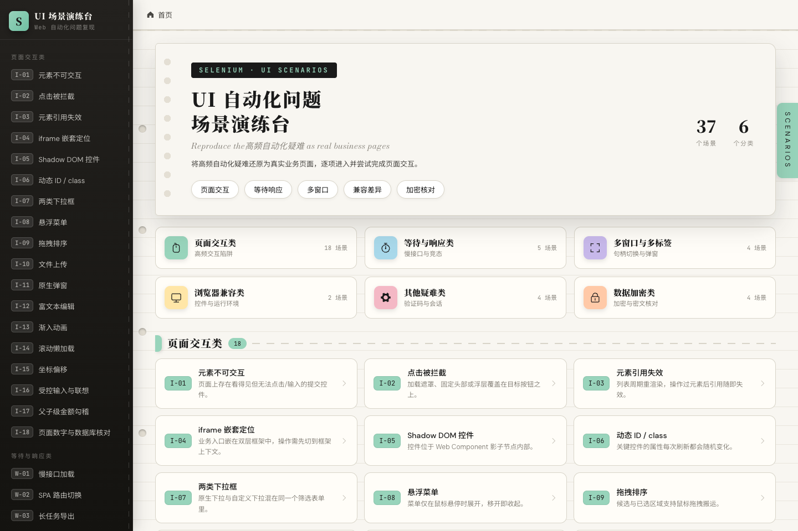
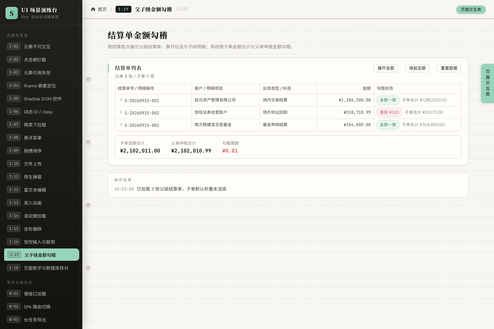
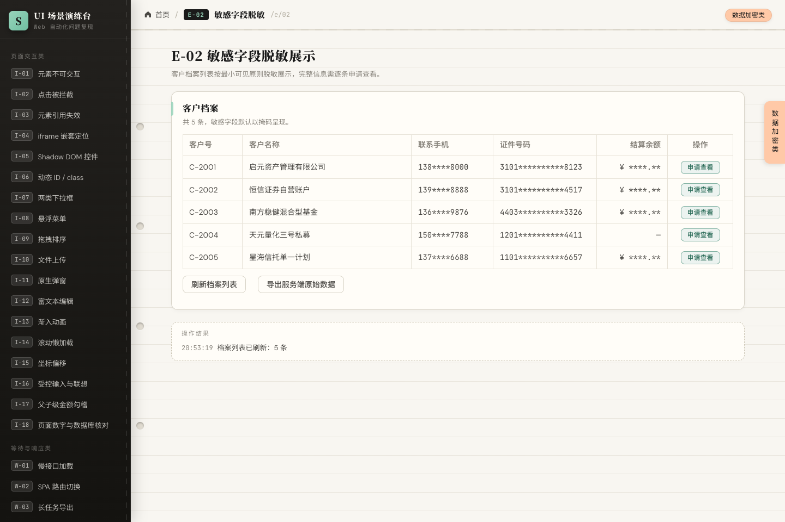

# UI 自动化问题场景演练台（Vue 3 + Flask）

**简体中文** | [English](./README.md)

把 [selenium_common_problems.md](./selenium_common_problems.md) 中高频的 Selenium Web UI 自动化问题，还原成**行为有缺陷但外观正常的业务页面**。练习者用 Selenium 打开对应路由即可复现「不可交互 / 点击被拦截 / 旧元素引用 / iframe / Shadow DOM / 假下拉 / 弹窗 / 等待竞态 / 多窗口 / 验证码 / 字段加密 / 脱敏展示 / 密文存储 / 报文签名」等真实故障。

页面内**不含任何答案提示**，所有「如何复现 + 解决要点 + 无法复现项」统一沉淀在本文档。

> **使用范围声明**
> 本项目是**本地练习靶场**，出于教学目的故意保留了不安全设计：硬编码 `SECRET_KEY`、默认开启的万能验证码 `1234`、`0.0.0.0` 监听、`CRYPTO_ECHO_PLAINTEXT` 明文回显后门、无鉴权的造数接口。
> 请仅在本地或隔离网络中使用，**禁止部署到公网，禁止用于任何生产环境**。

---

## 界面预览

| 首页（37 个场景 / 6 个分类） | 场景示例：I-17 父子金额勾稽 | 场景示例：E-02 敏感字段脱敏 |
| --- | --- | --- |
|  |  |  |

---

## 目录

- [一、快速开始](#一快速开始)
- [二、场景总览](#二场景总览)
- [三、逐场景复现步骤与解决要点](#三逐场景复现步骤与解决要点)
- [四、后端接口契约](#四后端接口契约)
- [五、无法用纯前后端复现的问题](#五无法用纯前后端复现的问题)
- [六、练习建议](#六练习建议)
- [七、贡献与许可](#七贡献与许可)

---

## 一、快速开始

### 1.1 环境要求

| 依赖 | 版本要求 | 用途 |
| --- | --- | --- |
| Node.js | ≥ 20.19（或 ≥ 22.12，Vite 8 的硬性要求；开发环境为 22+） | 前端 Vite 构建 |
| Python | ≥ 3.9（验证于 3.13 / 3.14） | Flask 后端 |
| cryptography | ≥ 42（`requirements.txt` 锁定 50.0.1） | 加密场景的 RSA-OAEP / AES-GCM / HMAC |

### 1.2 启动后端（端口 5050）

```bash
cd backend
pip install -r requirements.txt   # 首次
python app.py
# 健康检查: GET http://127.0.0.1:5050/api/health
```

### 1.3 启动前端（端口 5173）

```bash
cd frontend
npm install        # 首次
npm run dev
# 打开 http://127.0.0.1:5173
```

前端已配置 Vite 代理：页面请求 `/api/*` 自动转发到 `127.0.0.1:5050`，全程同源，**Cookie / Session 不需要处理跨域**。

端口可整体平移（默认使用 5050 而非 5000，是因为 macOS 的「隔空播放接收器」常占用 5000）：

```bash
APP_PORT=6000 python app.py          # 后端
VITE_API_PORT=6000 npm run dev       # 前端（代理目标随之改为 6000）
```

### 1.4 安卓平板 / 局域网访问

前后端均以 `0.0.0.0` 监听（`vite.config.js` 的 `server.host`、`app.py` 的 `run(host=...)`），同一局域网内的安卓平板可直接以 H5 方式访问，无需构建产物：

1. 查 PC 局域网 IP（Windows CMD）：`ipconfig`，取网卡 `IPv4 地址`（如 `192.168.x.107`）。
2. 首次放行 Windows 防火墙（管理员 PowerShell）：
   ```powershell
   netsh advfirewall firewall add rule name=Vite-H5-5173 dir=in action=allow protocol=TCP localport=5173
   netsh advfirewall firewall add rule name=Flask-API-5050 dir=in action=allow protocol=TCP localport=5050
   ```
3. 平板浏览器打开 `http://<PC的IP>:5173`。

注意：PC 与平板须在同一网段且路由器未开 AP 隔离；PC 有多个网卡时选与平板同网段的 IP。触摸端无 hover、文件选择框、原生弹窗等行为与桌面不同，正好复现文档标记的「环境类差异」；如需在平板跑真机自动化，可用 USB 连接 + `adb forward tcp:9515 tcp:9515` 后访问 `http://localhost:9515` 挂 Android WebDriver。

### 1.5 目录结构

```
FirstSeleniumUIEvent/
├── README.md                  # English documentation
├── README.zh-CN.md            # 本文档
├── CONTRIBUTING.md            # 贡献指南
├── CONTRIBUTING.en.md         # Contributing guide (English)
├── LICENSE                    # MIT
├── docs/screenshots/          # README 预览图
├── selenium_common_problems.md # 问题清单原始素材
├── backend/
│   ├── app.py                 # Flask 入口（threaded 启动）
│   ├── config.py              # 万能验证码 / 延迟 / 任务时长等集中配置
│   ├── db.py                  # SQLite 数据层（backend/data/settlement.db，金额以「分」落库）
│   ├── crypto_util.py         # RSA-OAEP / AES-256-GCM / HMAC-SHA256（密钥随进程随机生成）
│   ├── vault_db.py            # 密文库（backend/data/crypto_vault.db，敏感字段加密落库）
│   ├── requirements.txt
│   └── api/                   # slow / export / captcha / auth / settlement / dbconsistency / crypto
└── frontend/
    ├── vite.config.js         # /api 代理 → 5050
    ├── public/iframes/        # frame-a / frame-b / oauth / detail 静态页
    └── src/
        ├── data/scenarios.js  # 场景目录单一数据源（驱动导航 / 首页 / 路由）
        ├── layout/            # 平台壳
        ├── utils/crypto.js    # 浏览器 Web Crypto 封装（非安全上下文降级为服务端代加解密）
        ├── views/             # 37 个场景页（interact/wait/window/compat/misc/crypt）
        └── components/shadow-widget.js  # Shadow DOM 复现组件
```

---

## 二、场景总览

首页可一键进入全部场景。页面通用断言锚点：每页底部 **「操作结果」** 区域会输出日志，Selenium 脚本用它断言操作是否生效。

| 编码 | 路由 | 页面文件 | 一句话说明 |
| --- | --- | --- | --- |
| I-01 | /i/01 | interact/01-not-interactable | 禁用按钮 / 折叠内未渲染控件 |
| I-02 | /i/02 | interact/02-click-intercepted | 计算遮罩覆盖目标按钮 |
| I-03 | /i/03 | interact/03-stale-element | 列表周期性整体重建 |
| I-04 | /i/04 | interact/04-iframe-nested | 双层 iframe 内提交报销单 |
| I-05 | /i/05 | interact/05-shadow-dom | Web Component 影子内部按钮 |
| I-06 | /i/06 | interact/06-dynamic-attributes | id / class 随机变化 |
| I-07 | /i/07 | interact/07-dropdowns | 原生 select + 组件下拉混排 |
| I-08 | /i/08 | interact/08-hover-menu | hover 展开菜单 / 行操作 |
| I-09 | /i/09 | interact/09-drag-drop | HTML5 拖拽分配 |
| I-10 | /i/10 | interact/10-file-upload | input[type=file] 上传 |
| I-11 | /i/11 | interact/11-native-dialogs | alert / confirm / prompt |
| I-12 | /i/12 | interact/12-rich-text | contenteditable 富文本 |
| I-13 | /i/13 | interact/13-animation | 渐入位移动画面板 |
| I-14 | /i/14 | interact/14-lazy-load | 滚动懒加载分页列表 |
| I-15 | /i/15 | interact/15-coordinate-offset | 裁切 / 缩放上下文内的目标点 |
| I-16 | /i/16 | interact/16-controlled-input | 受控输入 + 异步联想 |
| I-17 | /i/17 | interact/17-parent-child-amount | 结算单父子金额勾稽（折叠 / 同名列 / 尾差） |
| I-18 | /i/18 | interact/18-page-db-consistency | 页面数字与数据库核对（分页 / 单位「分」/ 汇总漂移 / NULL） |
| W-01 | /w/01 | wait/01-slow-loading | 慢接口 + 加载遮罩 |
| W-02 | /w/02 | wait/02-spa-route-switch | SPA 子视图切换（URL 变化无刷新） |
| W-03 | /w/03 | wait/03-export-task | 异步导出长任务轮询下载 |
| W-04 | /w/04 | wait/04-race-assert | 保存后数据延迟落库 |
| W-05 | /w/05 | wait/05-unstable-api | 偶发失败 + 随机延迟 |
| M-01 | /m/01 | window/01-new-tab | target=_blank 打开详情 |
| M-02 | /m/02 | window/02-oauth-popup | OAuth 授权小窗自动关闭回传 |
| M-03 | /m/03 | window/03-window-iframe | 新窗口内再套 iframe |
| M-04 | /m/04 | window/04-popup-blocked | 延时 window.open 被拦截 |
| C-01 | /c/01 | compat/01-date-input | 原生日期 / 时间控件 |
| C-02 | /c/02 | compat/02-env-info | 浏览器环境信息采集 |
| X-01 | /x/01 | misc/01-captcha | 服务端图形验证码 |
| X-02 | /x/02 | misc/02-bot-detection | navigator.webdriver 特征校验 |
| X-03 | /x/03 | misc/03-cookie-session | 会话 Cookie 登录态 |
| X-04 | /x/04 | misc/04-seed-data | 服务端造数自造自销 |
| E-01 | /e/01 | crypt/01-transport-encryption | 表单字段 RSA 加密后提交 |
| E-02 | /e/02 | crypt/02-masked-display | 脱敏列表 + 限时查看明文 |
| E-03 | /e/03 | crypt/03-cipher-storage | 库中 AES 密文与多版本密钥核对 |
| E-04 | /e/04 | crypt/04-response-encryption | 接口报文整体加密 + 时间戳 / 签名校验 |

---

## 三、逐场景复现步骤与解决要点

### I-01 元素不可交互（ElementNotInteractable / NoSuchElement）
- **复现**：打开 `/i/01`。不勾选须知直接点「保存交接记录」（按钮 disabled，点击无效果）；不展开折叠面板直接点「应用高级配置」（内部元素未渲染，找不到）。
- **解决要点**：先判断元素是否真的可交互（`is_displayed` / `is_enabled`）；受控表单先勾选同意，再用 `WebDriverWait(...).until(EC.element_to_be_clickable(...))` 后点击；折叠内容需先点「展开高级配置」；不要在 `disabled` 状态下直接 `click()`。

### I-02 点击被拦截（ElementClickIntercepted）
- **复现**：打开 `/i/02` 点击「生成对账结果」。计算期间出现半透明遮罩覆盖表格区域，此时点「下载对账结果」会被拦截；约 3.6s 后遮罩消失才可点。
- **解决要点**：点击前等待遮罩消失（`invisibility_of_element_located` 或显式条件），优先 `element_to_be_clickable`；必要时用 `execute_script('arguments[0].click()')` 绕过遮挡，但要另行断言后续业务状态。

### I-03 元素引用失效（StaleElementReference）
- **复现**：打开 `/i/03`，开启「自动刷新」后先定位一行「查看」，等 5s 列表自动重建再点击 → 旧引用失效。
- **解决要点**：不要在循环外缓存 `WebElement`；每次操作前重新定位；捕获异常后重试定位；用唯一文本或 key 重新查找。

### I-04 iframe 嵌套
- **复现**：`/i/04` 内嵌双层 iframe（frame-a → frame-b）。切到最内层填表提交后，顶层主页面收到消息并写入日志（单号 / 金额）。
- **解决要点**：`driver.switch_to.frame(...)` 逐层进入、逐层退出；用 iframe 内稳定 id（`reason` / `amount` / `dept`）；完成后 `switch_to.default_content()` 复位。

### I-05 Shadow DOM
- **复现**：`/i/05` 的「外层保存」与「执行内部任务」按钮位于自定义元素影子根内，内层还套第二层影子，常规 `find_element` 找不到。
- **解决要点**：Selenium 4 + Chrome/Edge 可用 `shadow_root.find_element(...)` 逐层穿透；多层可用 `execute_script("return document.querySelector('#shadowBox').shadowRoot.querySelector('shadow-inner-box').shadowRoot.querySelector('button')")`；点击内层后，用外层「读取影子节点状态」验证。

### I-06 动态 id / class
- **复现**：`/i/06` 每次「重新生成控件属性」或刷新页面，输入框 / 按钮的 `id`、`class` 随机变化，`placeholder` 与按钮文案稳定。
- **解决要点**：改用相对定位：`//input[@placeholder='请输入资产编号']`、`//button[contains(text(),'提交资产信息')]`、`css=[placeholder=...]`；不要依赖随机 id。

### I-07 两类下拉框
- **复现**：`/i/07` 区域下拉是原生 `<select>`（选项在页面内），业务类型下拉是组件自绘（选项浮层挂到 body 下）。
- **解决要点**：原生用 `Select(...).select_by_visible_text('华北直辖区')`；自绘下拉先点触发器 → 等浮层选项可见（`WebDriverWait` + `element_to_be_clickable`）再点选项；注意浮层是否位于另一层上下文。

### I-08 悬浮菜单
- **复现**：`/i/08` 顶部「运营动作」子菜单与每行操作按钮仅悬停出现，鼠标移开即收起。
- **解决要点**：`ActionChains(driver).move_to_element(menu).perform()` 后等子项可见再点；行操作需先悬停到目标行。

### I-09 拖拽
- **复现**：`/i/09` 把候选配送员拖到「已选」区，再拖回候选区。
- **解决要点**：HTML5 拖拽建议 `ActionChains.drag_and_drop` 或按 `dragstart` 序列模拟；若 drag 事件未触发，可用脚本构造 `DataTransfer`（详见「不可复现项」说明）。

### I-10 文件上传
- **复现**：`/i/10` 点击「选择合同文件」弹出系统文件框（页面内提供隐藏 `input[type=file]`）；选定后回显文件名 / 大小，点「提交登记」走 `/api/upload`。
- **解决要点**：直接定位 `input[type=file]` 后 `send_keys('本地绝对路径')`，无需操作系统文件框；断言结果区出现登记号 `UP-...`。

### I-11 原生弹窗 alert / confirm / prompt
- **复现**：`/i/11` 查看告警（alert）、确认补货（confirm）、登记备注（prompt），均为浏览器原生阻塞弹窗。
- **解决要点**：`driver.switch_to.alert` → `accept()` / `dismiss()`；prompt 先 `send_keys` 再 accept；弹窗未处理时不要再等页面元素。

### I-12 富文本 contenteditable
- **复现**：`/i/12` 在可编辑区输入并排版后点「发布公告」；正文或标题为空会提示。
- **解决要点**：对 `contenteditable` 先 `click()` 聚焦再 `send_keys`；断言用正文文本（可读 `innerText`）；`execCommand` 加粗等为可选项。

### I-13 动画渐入
- **复现**：`/i/13` 点「打开最新推送」，面板带 2.4s 渐入 + 位移；动画过程中点击「我知道了」不稳定。
- **解决要点**：等元素稳定再操作（轮询位置，或等 `animationend`，观察「渲染中…→已就绪」徽标变化）；避免在动画首帧点击。

### I-14 滚动懒加载
- **复现**：`/i/14` 列表容器滚动到底自动请求 `/api/items?page=N`，每次追加 10 条，直至 160 条。
- **解决要点**：滚动容器直到出现新数据或「已加载全部任务」；等第 N+1 条元素出现再断言；注意滚动的是**页面内子容器**而非 `window`。

### I-15 坐标 / 位置偏移（结构层面复现）
- **复现**：`/i/15`「目标货架」按钮默认位于缩略裁切区之外，「展开完整区域」后才可点击；「获取目标点位坐标」输出 `rect` 与 `devicePixelRatio` 供对照。
- **解决要点**：优先元素级 click 而非固定坐标；需要先滚动 / 展开再操作；DPR 与页面缩放在 C-02 查看。**纯 DPI / 系统缩放类偏移无法在 Web 页内真实制造**（见「不可复现项」）。

### I-16 受控输入与联想
- **复现**：`/i/16` 客户名称必须真实键入才进入内部状态，仅 JS 赋值不触发事件则「校验并提交」报未录入；搜索联想 700ms 后出现候选；「清空备注」演示清除。
- **解决要点**：用真实键入（`send_keys`）；必须脚本注入时需派发 `input` 事件；等联想项出现后点击再断言；清空用选中后 `Backspace` 或 `clear()`。

### I-17 父子级金额勾稽（结算单）
- **复现**：`/i/17` 展示 3 张父级结算单，子级明细默认折叠；点父行展开箭头（或「展开全部」）才渲染子行。子行「调整」改金额保存后，后台约 0.8s 才刷新父单「子单合计 / 差异」；`S-20260915-002` 申报 ¥510,710.99 与子单合计 ¥510,711.00 固定存在一分钱尾差；`D-0014` 为负数，显示为 `(¥3,400.00)`。
- **解决要点**：
  1. 子行未展开时 DOM 不存在 → 先点展开图标（`.el-table__expand-icon`）或「展开全部」再等子行出现。
  2. 父子行金额单元格 class 相同、文案同格式 → 必须按行层级限定：子行 `//tr[contains(@class,'el-table__row--level-1')]`、父行 `--level-0`；树形行是平铺的 `<tr>`，靠 level class 区分父子。
  3. 金额是格式化文本（`¥1,286,500.00`、负数 `(¥3,400.00)`）→ 断言前清洗货币符号与千分位，括号按负数处理。
  4. 保存后父单合计异步刷新 → 不要立刻断言，等父行状态标签由「差异」变「金额一致」，或等结果区出现「重算完成」。
  5. 金融金额禁止 float 相等比较 → 用 `Decimal` 或容差（`abs(diff) < 0.005`）；`/api/settlement/recalc` 的 `rawChildTotal` 可见浮点求和的 0.0000000x 尾差。

### I-18 页面数字与数据库一致性核对（SQLite 真实落库）
- **复现**：`/i/18` 分页展示 15 条结算明细（每页 5 条）与 4 个资金账户；底部汇总卡取的是「结算单汇总字段合计」，而非明细实时求和。点「数据库查询」可查看库表原始行（`settle_bill` / `settle_detail` / `fund_account`，金额单位为**分**，未清算行为 `NULL`）。「模拟清算入账」直接改库但页面不刷新；明细「调整」只写明细表、不回写结算单汇总字段，「重算汇总」才按明细回写。
- **数据库位置**：`backend/data/settlement.db`，可用 `sqlite3` 或 DBeaver 打开核对。
- **解决要点**：
  1. 单位不一致：库存「分」（`amount_cents=86230000`）、页面显示「元」（`¥862,300.00`）→ 断言前统一换算，推荐以库侧整数分为基准。
  2. 分页截断：页面只有当前页 5 行，直接对表格行求和必然漏数据 → 翻完 3 页，或用 `/api/dbconsistency/db/query?target=settle_detail` 取全量。
  3. 汇总字段漂移：`S-20260915-002` 的 `total_amount_cents` 比明细求和多 1 分（页面合计 `¥2,124,273.51` vs 明细求和 `¥2,124,273.50`）→ 汇总表与明细表是两类数据源，需分别取、分别比。
  4. 未清算行：D-0023 库中为 `NULL`，页面显示「—」→ 求和时 NULL 按 0 处理，且断言要能区分「0」与「未清算」。
  5. 陈旧读数：入账后库已变、页面快照未刷新 → 先记页面「数据快照」时间，刷新后再取数，或等 `updated_at` 变化再断言。
  6. 格式化文本：`¥1,286,500.00`、负数 `(¥98,000.00)` → 清洗千分位与括号后再比较，不要用字符串相等判断金额。

### W-01 慢接口 + loading
- **复现**：`/w/01` 选档位后查询，请求期间出现 `v-loading` 全屏遮罩，3s / 8s 档位差异明显。
- **解决要点**：用显式等待等结果表格行出现（`presence_of_element_located`）或遮罩消失；慢接口不要依赖固定 `sleep`，需动态等待。

### W-02 SPA 无刷新切换
- **复现**：`/w/02` 点三个子视图按钮，URL 变为 `/w/02?view=...` 但无整页刷新（页面存活秒数持续增加可验证）。
- **解决要点**：SPA 等待脚本要关心 URL / 路由变化或新渲染文本，不要等 `document.readyState` / `window.onload`；可轮询直到目标子视图标题出现。

### W-03 长任务导出 + 轮询下载
- **复现**：`/w/03` 发起导出约 10s（服务端线程推进进度），完成后出现「下载导出文件」，下载走 `/api/export/file/{task_id}`。
- **解决要点**：轮询 `/export/status/{id}` 直至 `done`（或等下载按钮 `element_to_be_clickable`）再断言；浏览器下载文件校验属框架侧配置（下载目录 / prefs）。

### W-04 保存后竞态断言
- **复现**：`/w/04` 点保存约 2.6s 才落库，落库前「刷新已存记录」列表为空 —— 保存后立刻断言即失败。
- **解决要点**：保存后不要立即断言列表；轮询直至新单号出现（`text_to_be_present_in_element`），或等保存请求返回后再查询；区分「请求完成」与「数据可读」。

### W-05 不稳定接口
- **复现**：`/w/05` 同步约 30% 概率直接失败，其余在 0.5~5s 随机延迟后成功；页面提供重试入口。
- **解决要点**：健壮用例需带重试与超时策略；断言最终成功状态而非一次性结果；日志区分服务 500 与超时。

### M-01 新标签页
- **复现**：`/m/01` 单据号以新标签（`target=_blank`）打开 `/iframes/detail.html?id=...`，也提供 `window.open` 触发。
- **解决要点**：操作前记录 `window_handles` 数量，切到最新句柄；完成后切回主句柄。

### M-02 OAuth 授权小窗
- **复现**：`/m/02` 点「发起授权登录」弹出小窗；小窗内点「同意并授权」会 `postMessage` 回主窗口并自动关闭，主页面「授权状态」变为已授权。
- **解决要点**：等新窗口出现 → 切句柄 → 小窗内操作 → 等窗口自动关闭或切回主句柄断言「已授权」；被拦截时调整浏览器弹窗策略。

### M-03 新窗口 + iframe
- **复现**：`/m/03` 点「在新窗口处理申请」打开 frame-a 页面（内含二层 iframe）；可在新窗口完成内层提交后回主窗口「登记主档」。
- **解决要点**：句柄切换 + 框架切换组合：新窗口 → `switch_to.frame` 逐层进入 → 操作 → 逐级 `default_content` → `switch_to.window(主句柄)`。

### M-04 非用户手势弹窗被拦截
- **复现**：`/m/04`「延时打开预览」在 `setTimeout` 后执行 `window.open`，Chrome 等常拦截并返回 `null`（页面记录「被拦截」次数）；「立即预览」在用户手势内通常成功。
- **解决要点**：测试配置需放行弹窗（capability 或浏览器设置）；避免依赖非手势 `window.open`；断言页面记录的打开 / 拦截计数。

### C-01 原生日期 / 时间控件
- **复现**：`/c/01` 提供 date / time / datetime-local 五个原生输入，各浏览器 UI 差异大。
- **解决要点**：Chrome 可 `send_keys('2026-09-12')` 或操作日历 UI；Edge / Firefox 行为不同需分别适配；断言用 value 而非控件 UI；配合 `Keys.ENTER` 或失焦触发。

### C-02 环境信息
- **复现**：`/c/02` 展示 UA、DPR、分辨率、语言、`navigator.webdriver` 等只读环境参数。
- **解决要点**：用于核对 driver 与页面环境一致性；断言环境差异用例时以本页文本为基准；页面本身不制造故障。

### X-01 图形验证码
- **复现**：`/x/01` 验证码由 Flask + Pillow 动态生成；输错 / 过期会提示并自动刷新图片。
- **解决要点**：测试环境用万能码 `1234`（`config.py` 的 `CAPTCHA_UNIVERSAL_ENABLED` 可关闭）；或集成 OCR / 打码平台（需自备）；接口为 `GET /api/captcha` 取 `sid` 与图片、`POST /api/captcha/verify` 校验。

### X-02 自动化特征检测
- **复现**：`/x/02`「执行环境校验」读取 `navigator.webdriver`；Selenium 默认下为 `true`，判定「检测到自动化特征」，摘要生成受限并出现限制提示。
- **解决要点**：理解 webdriver 检测行为；常规自动化可使用带反检测配置的驱动处理；本页仅用于观察特征值（C-02 亦展示），不代表真实站点反爬强度。

### X-03 会话 Cookie 登录态
- **复现**：`/x/03` 用 `tester` / `demo` 登录后刷新或重开标签仍为登录态（session Cookie）；删除 Cookie 或退出后「重新检测登录态」为未登录。
- **解决要点**：自动化中用 `delete_all_cookies` 验证登录失效逻辑；多场景共享登录态时注意 Cookie 隔离；勾选「记住登录状态」影响 Cookie 持久时长。

### X-04 数据自造自销
- **复现**：`/x/04` 点「生成工单编号」由 `/api/seed/new` 造唯一数据，再「归档此工单」消费；「查询服务端已生成数据」展示累计。
- **解决要点**：演示造数—用数模式；测试数据由接口生成，用唯一编号断言；服务端为内存态，重启后端即清空。

### E-01 传输字段加密（RSA-OAEP）
- **复现**：`/e/01` 打开后公钥**异步签发**（0.3~0.8s），未就绪时点「加密并提交」会失败；就绪后填密码提交，页面下方「最近一次请求报文」中只有 `credentialB64` 密文，**没有 password 明文**；同一密码提交两次密文完全不同（OAEP 随机填充）；点「重新签发公钥」后旧密文提交会失败；「明文提交（旧通道）」被服务端拒绝。
- **解决要点**：
  1. 公钥是异步资源 → 先 `WebDriverWait` 等 `#pubkey-fingerprint` 出现非「—」文本（或 READY 标签），再点提交。
  2. `input#login-password` 的 DOM value 是明文，但**线上报文是密文** → 断言「是否加密」要看 `#request-body`，或用 CDP / selenium-wire 抓真实请求体；仅 `get_attribute('value')` 证明不了任何事。
  3. 密文每次不同 → **禁止**用密文做相等断言；响应也不回显明文口令，只回 `serverDigest`（服务端对解密结果算的 SHA-256 前 16 位大写）与掩码 → 脚本按同样算法对明文算摘要后与 `#server-digest` 比对（页面同时展示 `#local-digest` 与 `#digest-match`）。
  4. 明文通道：`code=1001`（HTTP 仍为 200，全局 `ElMessage` 弹层会自动消失 → 断言以「操作结果」日志为准）。
  5. 密钥轮换场景：`code=1003`，旧密文必须重新加密；脚本缓存的密文 / 公钥指纹需一并失效。
  6. 非安全上下文（`http://IP:5173` 平板访问）下浏览器无 `crypto.subtle`，页面自动降级为服务端代加密，行为一致但不代表真实客户端 SDK 也如此；此时无法本地算摘要，`#digest-match` 显示「未比对」，断言只能用 `#server-digest`。
  7. 场景边界：E-01 只演示**请求侧**字段加密，响应体本身未加密（真实登录接口通常如此）；整体报文加密见 E-04。确需接口回显明文辅助调试时置 `config.CRYPTO_ECHO_PLAINTEXT = True`（默认 `False`），生产环境严禁。

### E-02 敏感字段脱敏展示
- **复现**：`/e/02` 表格里手机号为 `136****9876`、证件为 `4403**********3326`、余额为 `¥ ****.**`；第 3 行 `.cell-mobile` 上带 `data-raw="13600129876"`（真实号码泄漏在属性里），其他行没有；点「申请查看」抽屉显示明文并**倒计时自动收起**，冷却期内重复点同一行会失败；未登记余额显示「—」。
- **解决要点**：
  1. 页面文本是掩码 → 断言完整值必须走服务端数据源 `GET /crypto/masked/raw`，或「导出服务端原始数据」表格（`.raw-row-<id>`）。
  2. `data-raw` 是**脏路径**：能取到但只覆盖个别行，依赖它会在其他行静默失败；只可辅助，不能作主断言口径。
  3. 抽屉限时自动收起 → 打开后**立即**读取 `#reveal-mobile`，不要在其中插入长 `sleep`。
  4. 同一记录 5 秒冷却（`code=1002`）→ 批量核对要换记录，或等冷却结束。
  5. 退化文本区分：未登记是「—」，金额为 0 时是 `¥ 0.00`，两者断言不能混。

### E-03 密文存储与页面数据核对（AES-256-GCM 真实落库）
- **复现**：`/e/03` 档案列表展示**服务端解密后的明文**，而 `GET /api/crypto/vault/db/query` 或直接打开 `backend/data/crypto_vault.db` 看到的全是密文；6 条记录分 2 页（每页 5 条）；`C-1005` 使用历史密钥 K1，`C-1006` 使用已吊销密钥 K0（页面显示「解密失败」），`C-1004` 余额未登记（库中 `NULL`）；同一手机号重复登记时 `samePlainCount=2` 而密文完全不同。
- **解决要点**：
  1. 页面与库**不能直接字符串对照**：必须先解密再比（`POST /api/crypto/vault/decrypt`，或脚本侧用同一会话密钥自行 AES-GCM 解密）。
  2. IV 随机 → 同一明文两次加密密文必不相同，**禁止**密文相等断言；等值检索只能用库里的 `mobile_hmac` 摘要列。
  3. 多密钥版本：`C-1005` 必须显式带 `keyVersion=K1` 才能解开，默认版本会报「解密失败」；`C-1006`（K0）任何版本都解不开，属预期失败。
  4. 分页截断（6 条 2 页）→ 只对当前页计数或求和必然漏数据，需翻页或直接取 `/db/query` 全量。
  5. 三种状态分开：解密成功 / 「解密失败」（密钥问题）/ 「—」（库中 NULL）。
  6. 密钥每次进程启动随机生成、密文库随之重建 → 跨会话缓存的密文必然失效，重跑前先重新取数（`/api/crypto/vault/reset` 可强制换密钥重建）。

### E-04 接口报文整体加密 + 时间戳 / 签名
- **复现**：`/e/04` 选通道状态后「拉取加密报文」，服务端返回的 `encB64` / `ivB64` / `ts` / `sign` 全为密文，页面拿到会话密钥后本地解密渲染成交明细；选「过期时间戳」再点「校验此报文」返回 `code=2001`，选「签名被篡改」返回 `code=2002`，只有正常报文能校验通过。
- **解决要点**：
  1. 直连接口取到的是密文，不能直接断言内容 → 解密口径：`GET /api/crypto/session-key` 取密钥 → AES-256-GCM 解密（Python `cryptography` 与浏览器 Web Crypto 结果一致），或读页面 DOM `.env-row` / `.env-amount`。
  2. 时间戳窗口 ±120 秒 → 拿到 `ts` 后尽快校验；缓存报文隔几分钟再验必过期（`code=2001`）。
  3. 「签名被篡改」模式下**密文本身没坏**（仍可正常解密，5 条明细照常渲染）→ 解密成功 ≠ 校验通过，两个断言必须分开。
  4. 失败提示由全局 `ElMessage` 承载并自动消失 → 断言务必读「操作结果」日志区。
  5. 脱离浏览器验证时可直接 `requests`：`envelope` → `session-key` → 解密 → `envelope/verify` 四步串联，用于 CI 接口层用例。

---

## 四、后端接口契约

统一响应：`{ "code": 0|非0, "data": ..., "message": "..." }`，`code=0` 表示成功。

| 接口 | 方法 | 说明 |
| --- | --- | --- |
| /api/health | GET | 健康检查 |
| /api/slow/items?delay=3 | GET | 延迟后返回 20 条数据 |
| /api/unstable | GET | 约 30% 返回 500，其余 0.5~5s 后成功 |
| /api/items?page=1&size=10 | GET | 分页懒加载数据（共 160 条） |
| /api/upload | POST | 文件上传登记（multipart） |
| /api/race/save · /api/race/list | POST / GET | 竞态保存（约 2.6s 落库）与列表 |
| /api/seed/new · /api/seed/list | POST / GET | 唯一造数与已生成列表 |
| /api/export/start · /status/{id} · /file/{id} | POST / GET / GET | 导出长任务：进度 0-100，完成后下载 CSV |
| /api/captcha · /captcha/verify | GET / POST | 验证码 PNG(base64) + 校验（支持万能码 1234） |
| /api/auth/login · /me · /logout | POST / GET / POST | 会话登录态（session Cookie） |
| /api/settlement/list | GET | 父级结算单 + 子级明细 |
| /api/settlement/recalc | POST | 子单改金额后重算父单（约 0.8s），返回 childTotal / diff / state |
| /api/settlement/reset | POST | 重置结算数据，保证练习可重复 |
| /api/dbconsistency/page?page=1 | GET | 明细分页 + 汇总卡片（汇总字段合计 / 明细求和 / 账户合计 / 快照时间） |
| /api/dbconsistency/db/meta | GET | 库文件路径与三张表的行数、最后更新时间 |
| /api/dbconsistency/db/query?target=settle_detail | GET | 直查库表原始行（金额单位：分，NULL 保留） |
| /api/dbconsistency/detail/update | POST | 改明细金额（约 0.6s），不回写结算单汇总字段 |
| /api/dbconsistency/bill/recap | POST | 按明细求和回写结算单汇总字段 |
| /api/dbconsistency/account/post | POST | 模拟清算入账（改库，页面不刷新） |
| /api/dbconsistency/reset | POST | 重建数据库，恢复初始数据 |
| /api/crypto/pubkey | GET | RSA 公钥 PEM + 指纹（延迟 0.3~0.8s，需等待） |
| /api/crypto/pubkey/rotate | POST | 轮换密钥对，轮换前的密文随即失效（1003） |
| /api/crypto/session-key | GET | 会话 AES-256-GCM 密钥（base64），供脚本侧解密 |
| /api/crypto/encrypt · /crypto/decrypt | POST | 通用加解密通道（alg=RSA-OAEP / AES-GCM），非安全上下文降级用 |
| /api/crypto/login/encrypted | POST | RSA 密文登录，返回解密摘要 + 掩码；明文回显开关见 `config.CRYPTO_ECHO_PLAINTEXT` |
| /api/crypto/login/plain | POST | 对照组：明文提交被拒（1001） |
| /api/crypto/masked/customers | GET | 脱敏客户列表（个别行带 data-raw 明文泄漏） |
| /api/crypto/masked/reveal | POST | 单条明文查看，5 秒冷却（1002） |
| /api/crypto/masked/raw | GET | 服务端全量明文，脱敏断言的稳定数据源 |
| /api/crypto/vault/page?page=1 | GET | 解密后的密文档案分页（5 条/页） |
| /api/crypto/vault/db/query · /db/meta | GET | 库表原始密文行 + 库元信息（行数 / keyVersion 分布） |
| /api/crypto/vault/decrypt | POST | 按密钥版本解密单字段（失败返 2003） |
| /api/crypto/vault/write | POST | 新档案登记，返回本次密文与同明文份数 |
| /api/crypto/vault/reset | POST | 重建密文库（进程内密钥随之重生成） |
| /api/crypto/envelope?mode=normal·expired·tampered | GET | 加密报文：密文 + IV + ts + sign |
| /api/crypto/envelope/verify | POST | 时间戳（±120s，2001）+ HMAC 签名校验（2002） |

可在浏览器 / 脚本直连：`http://127.0.0.1:5050/api/...`，或经前端代理 `http://127.0.0.1:5173/api/...`。

---

## 五、无法用纯前后端复现的问题

以下内容与浏览器内核、驱动、操作系统或 CI 强相关，**无法在本 Vue + Flask 演示平台内还原故障**，此处标注其性质与替代练习 / 处理建议：

| 问题点 | 是否可复现 | 说明与替代处理 |
| --- | --- | --- |
| 系统级文件选择对话框（原生 OS 弹窗） | ❌ 不可 | 只能通过页面隐藏 `input[type=file]` + `send_keys` 注入（I-10 已覆盖）；OS 弹窗需 pywinauto / AutoIt，属 Selenium 之外工具链 |
| 浏览器 driver / 版本不匹配、Selenium Manager 自动下载 | ❌ 不可 | 环境配置问题，与页面无关；建议锁 Chrome / Edge 版本 + WebDriver 版本一致的 CI 镜像 |
| headless 差异（字体、动画、窗口尺寸、`--headless=new` 行为） | ❌ 不可 | 由 driver options 触发；建议 CI 固定 headless 参数、安装中文字体、加 `--disable-dev-shm-usage` |
| Safari / Edge IE 模式 / 移动真机 Appium | ❌ 不可 | 本平台仅提供标准 Web 场景；C-02 可辅助核对 UA；浏览器差异需各自真机 / 真浏览器矩阵 |
| Selenium Grid / 分布式并行 | ❌ 不可 | 属测试框架与基础设施；本平台所有页面状态为服务端内存态，天然便于并行访问各路由 |
| 高分屏 DPI / 系统缩放与元素坐标错位 | ⚠️ 部分 | 页面只能给出缩放上下文结构（I-15）与 `devicePixelRatio` 读取（C-02）；真实坐标偏移取决于被测机系统缩放 |
| HTML5 拖拽是否触发 dragstart / drop | ⚠️ 视驱动 | 页面实现真实 drag 事件（I-09）；`ActionChains` 能否触发 `DataTransfer` 取决于浏览器 / 驱动实现 |
| 非手势 window.open 是否真的被拦 | ⚠️ 视策略 | M-04 如实执行延时 `window.open` 并回读是否被拦（null），是否拦截取决于浏览器弹窗设置 |
| 验证码 OCR / 打码平台 | ❌ 不可 | 平台提供服务端验证码（X-01）+ 万能码 `1234` 最佳实践；OCR 需外部服务 |
| 代理抓包（Charles / mitmproxy）配置 | ❌ 不可 | 属测试环境设施；平台均为本地 http，无证书问题（如需 https 可自行反代并信任自签证书） |
| Flaky 用例治理（失败重试、截图、Allure 报告） | ❌ 不可 | 属测试框架能力（pytest-rerunfailures、webdriver 截图等），需在工程侧落地 |
| driver.quit / 多线程共享 driver | ❌ 不可 | 属脚本工程规范；建议在 fixture / teardown 统一回收 |
| navigator.webdriver 反检测绕过 | ❌ 不提供 | X-02 / C-02 仅用于观察检测行为与读取特征，不提供规避手段 |
| 浏览器 Web Crypto 在非安全上下文不可用 | ⚠️ 部分 | `http://<IP>:5173` 访问时无 `crypto.subtle`；E-01 / E-04 已内置降级通道，真实客户端 SDK 不受此限制 |
| 硬件加密机 / KMS 托管密钥 / 国密 SM2·SM4 | ❌ 不可 | E-01~E-04 用软件实现的 RSA-OAEP + AES-GCM 演示同构流程，算法可替换为国密，加解密与断言口径不变 |

---

## 六、练习建议

1. 从 **I-01、I-02、W-01** 入手，体验最经典的「找不到 / 点不到 / 等不到」。
2. 每个页面先手动操作一遍，确认「正确结果」会出现在**操作结果**区，再用 Selenium 复刻。
3. 利用场景内故意改变状态的开关（I-03 自动刷新、I-15 展开完整区域、W-01 档位），练习**动态等待与异常恢复**。
4. 验证「等待类」功底用 W-03 / W-04 / W-05 组合：发起 → 轮询 → 落库 → 容错重试。
5. 验证「数据核对类」功底用 E-01~E-04 组合：密文传输 → 脱敏取值 → 库表解密比对 → 报文验签；断言必须落到**服务端数据源**而非页面文本。
6. 后端数据为内存态，**重启 Flask 即回到初始状态**，可反复练习（加密密钥同样随进程重建，重启后务必重新取数）。

---

## 七、贡献与许可

- 补充场景、修正文档或报告问题，请先阅读 [CONTRIBUTING.md](./CONTRIBUTING.md)（[English](./CONTRIBUTING.en.md)），其中写明了新增场景需要同步修改的四处文件、编码约定与不可提交项。
- 本项目采用 [MIT License](./LICENSE)，可自由用于学习、二次开发与内部培训。
- 免责声明：本平台仅用于**本地练习**，包含万能验证码、明文回显开关、硬编码密钥等**故意留下的不安全设计**，请勿部署到公网或用于任何生产环境。
